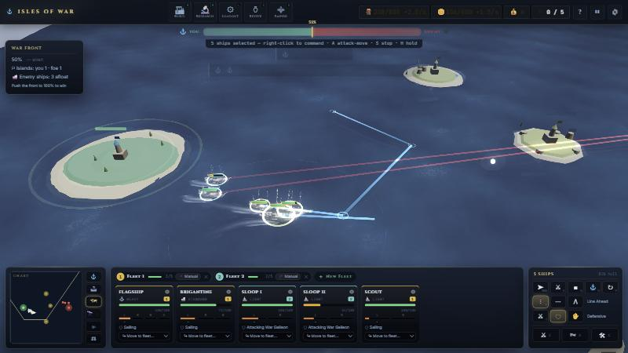

# Powder & Sail

A browser-based naval real-time strategy game built with Three.js. Plain ES modules, no bundler, runs offline (Three.js r128 and Rapier are vendored in `frontend/vendor/`).



## Running locally

Serve the **repository root** so both the game and the tests resolve their module paths:

```bash
node tools/serve.mjs 8080
```

(`python -m http.server 8080` from the repo root works too.) Then open:

- game: `http://localhost:8080/frontend/`
- tests: `http://localhost:8080/test/`

## Controls

The fleet is commanded like a classic RTS (StarCraft / Age of Empires conventions).

| Group | Input | Action |
| --- | --- | --- |
| Select | Click a ship · drag a box | Select (Shift adds / toggles) |
| | Double-click a ship | Every ship of that hull on screen |
| | `F2` or `Ctrl+A` | Select all ships |
| Fleets | `Ctrl+1–9` / `Shift+1–9` | Assign / add the selection to fleet N |
| | `1–9` (twice: centre camera) | Recall fleet N |
| Orders | Right-click | Smart order: sea → move · enemy ship → attack · enemy/neutral island → siege & capture · own island → sail alongside |
| | `Shift` + right-click | Queue a waypoint |
| | `A` / `P` then click | Attack-move / patrol |
| | `S` · `H` | Stop · hold position |
| | `F` · `T` | Cycle formation (Line Ahead / Line Abreast / Wedge) · cycle stance (Aggressive / Defensive / Hold Fire) |
| | `Z` `X` `C` | Commander abilities |
| Camera | Arrows · screen edge · middle-drag | Pan |
| | Wheel · `Space` | Zoom · centre on the selection |
| | Minimap | Click/drag: look · right-click: order the selection |
| Panels | `B` `R` `L` `V` `O` `M` | Build · Research · Loadout · Revive · Empire · Market |
| View | `Tab` · hold `Alt` · `Shift+F` | Range overlay · tactical view · fog of war |
| | `Esc` · `?` | Cancel / close / pause · help |

How ships fight: each ship keeps its own order queue. Group orders march in formation behind a shared anchor that plans a path around islands. Attack orders make a ship circle its target at the range of its strongest broadside, keeping the target abeam. Attack-move and patrol groups break formation to fight and rejoin afterwards; squadmates join a fight that one of them starts. Hulls handle differently: light ships turn tight and accelerate fast, heavy ships carve wide arcs.

## Folder structure

```text
iow_new_fable/
|-- README.md                 this file
|-- TODO.md                   active task list + milestone backlog
|-- docs/
|   |-- README.md             what each document is for
|   |-- FABLE_IOW_WORKLOG.md  session-by-session engineering log
|   |-- roadmap/              planning documents (AH–AZ roadmap)
|   |-- archive/              superseded handoffs and reviews (kept for history)
|   `-- img/                  screenshots referenced by the docs
|-- tools/
|   |-- serve.mjs             zero-dependency static server (Node)
|   `-- smoke_test.py         optional headless smoke test (Playwright)
|-- test/
|   |-- index.html            browser test runner
|   |-- harness.js            deterministic play harness (step frames, synthetic input)
|   `-- NN_*.test.js          suites
`-- frontend/
    |-- index.html            HUD markup + import map
    |-- Assets/               GLB models, sounds
    |-- vendor/               three.js r128, Rapier (offline)
    `-- src/
        |-- main.js           bootstrap: settings, panels, tutorial, game start
        |-- i18n.js           EN (source of truth, fallback) · VI · FR · JA
        |-- data/             plain data: ships, cannons, buildings, maps, commands …
        |-- styles/
        |   |-- main.css      base + earlier milestone layers
        |   `-- hud.css       command console, cards, ship bars, overlays (AU/AV)
        `-- Experience/
            |-- GameApp.js    wires everything and runs the frame loop
            |-- (core)        GameState, EventBus, InputManager, Time, Renderer, Physics …
            |-- Controllers/  Camera, Input (build/islands/panels), Command (RTS selection + orders), Scene, Building
            |-- World/        Ocean, Sky, islands, ships, wakes, CommandMarkers
            |-- Systems/
            |   |-- Naval/    OrderSystem, Navigation, Formations, MovementSystem, FleetCommander, Commander, Revive, Aura
            |   |-- Combat/   CombatSystem, StatusEffects
            |   |-- Economy/  Build, Economy, Trade, Research
            |   |-- Match/    WarFront, Capture, Waves, SeaEvents
            |   |-- AI/       EnemyAI
            |   |-- Vision/   Fog of war
            |   `-- VFX/      VFX facade + particles, explosions, fire …
            |-- UI/           HUD, CommandCard, ShipBars, Minimap, panels, toasts
            `-- Utils/        audio, model loader, ring materials, ship capacity
```

## Design principles

- **Single responsibility per file.** `GameApp` wires subsystems; logic lives in `Controllers/`, `Systems/`, `World/` and `UI/`.
- **Data separate from logic.** Balance numbers live in `frontend/src/data/` (e.g. `HULL_HANDLING` in `ships.js`, formations/stances/order tuning in `commands.js`).
- **Event bus over direct coupling** (`bus.emit` / `bus.on`) where practical.
- **No bundler.** Any static server runs the game. When a CSS or entry JS file changes, bump its `?v=` in `frontend/index.html`.

## Tests

Open `http://localhost:8080/test/`. Current status: **126 passed / 4 failed**. The 4 failures predate the AU milestone (Ocean zero-mean, ReviveSystem stub without a mesh, two SpringCamera settling checks) and are listed in `TODO.md`.

`test/harness.js` drives the live game deterministically from the console (works even when the tab is hidden):

```js
const h = await import('/test/harness.js');
h.rightClick(-40, 5);  h.step(600);  h.ships();
```

## Milestone history (short)

| Milestone | Highlights |
| --- | --- |
| AF–AH | Island shapes, GLB ships, VFX refactor, planar reflection, EnemyAI v2 |
| AI–AL | Fog of war, trade, new ships/cannons, PWA, tutorial |
| AM–AN | Post-FX, wind sway, toasts, floating numbers, vendored runtime, tactical view |
| AO–AP | Admiralty UI, island traits, adjacency, neutral starters, Empire overview |
| AQ–AR | SC2-style placement, dual theme, unified context dock |
| AS–AT | War Front tug-of-war, commander abilities, touch controls, tree instancing |
| AU | RTS command layer: selection, order queues, formations, stances, broadside engagement, island-aware pathing, fleets as control groups, RTS camera; repo reorganised |
| AV | HUD revamp: unified command console, ship cards, floating hull bars, order ribbons, restyled overlays, narrow-screen layouts |

Details per session are in `docs/FABLE_IOW_WORKLOG.md`.
